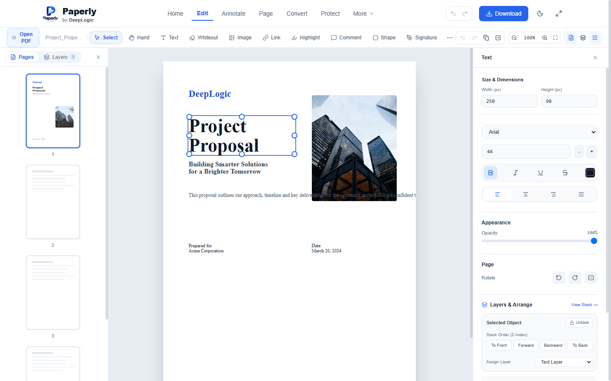
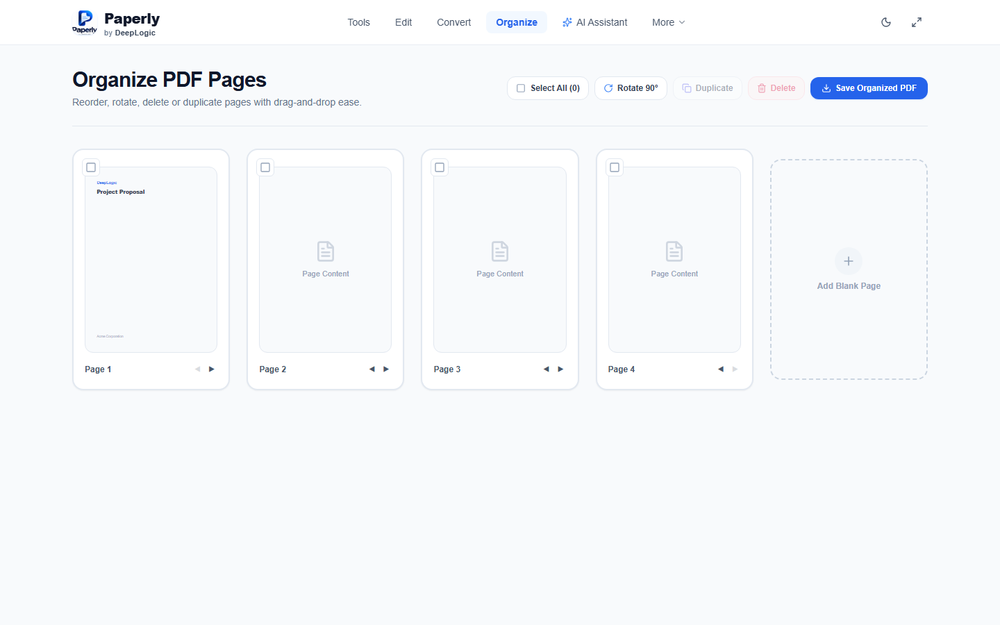
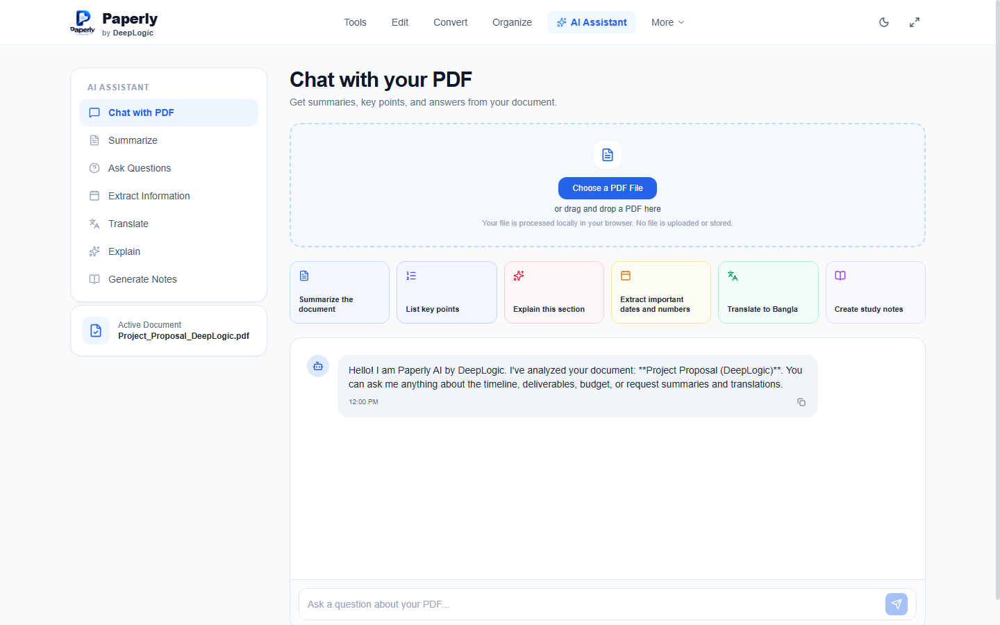

<p align="center">
  
</p>

<h1 align="center">Paperly</h1>

<p align="center">
  <strong>Your complete, privacy-first PDF toolkit — simple, powerful, and client-side.</strong><br />
  A product of <a href="https://deeplogic.agi.bd/"><strong>DeepLogic</strong></a>
</p>

<p align="center">
  <a href="#features">Features</a> •
  <a href="#screenshots">Screenshots</a> •
  <a href="#keyboard-shortcuts">Shortcuts</a> •
  <a href="#tech-stack">Tech Stack</a> •
  <a href="#getting-started">Getting Started</a> •
  <a href="#about-deeplogic">About DeepLogic</a> •
  <a href="#license">License</a>
</p>

<p align="center">
  <a href="https://deeplogic.agi.bd/"></a>
  
  
  
  
  
  
</p>

---

## 🌟 Overview

**Paperly** is a high-performance, web-based PDF editor and utility suite created by [**DeepLogic**](https://deeplogic.agi.bd/) for individuals and teams who require full desktop-grade PDF editing without compromising privacy. All operations — from direct text editing and vector drawing to page rearrangement and AI summarization — are executed **100% client-side** inside your browser. No files are uploaded to external servers.

---

## 📸 Screenshots

### 🛠️ Interactive PDF Editor
> Direct text editing, 8-point resizing handles, dedicated layer hierarchy, and comprehensive typography styling.

<p align="center">
  
</p>

<br />

### 🧰 All-in-One PDF Tools & Utilities
> Merge, split, compress, protect, convert, and organize PDF documents in one unified interface.

<p align="center">
  
</p>

<br />

### 📑 Drag-and-Drop Page Organizer
> Reorder, rotate, duplicate, delete, and insert blank pages effortlessly.

<p align="center">
  
</p>

<br />

### 🤖 Paperly AI Assistant
> Instant document chat, automated key-point extraction, summaries, and multilingual translations.

<p align="center">
  
</p>

---

## ✨ Key Features

### 📝 Direct & In-Place Text Editing
- **Click to Edit**: Click or double-click any original line of text on imported PDFs to edit in real time.
- **Smart Typography**: Match font family, font size, color, weight (bold), italic, underline, strikethrough, and alignment.
- **Precision Masking**: Automatic matched background mask prevents text overlapping or blurriness.

### 🎨 Shapes, Annotations & Signatures
- **Interactive Shapes**: Rectangles, customizable stroke widths, borders, and transparent fills.
- **Highlights & Whiteouts**: High-precision vector highlight bars and privacy whiteout redactions.
- **Signature Pad**: Draw, type, or upload digital signatures and place them anywhere on your document.
- **Image Insertion**: Embed images (PNG, JPEG, WebP) with arbitrary positioning and scaling.

### 📐 8-Point Resizing & Multi-Select Canvas
- **Corner & Edge Handles**: Smooth interactive resizing (top, bottom, left, right, and 4 corners).
- **Rubber-band Selection**: Drag a marquee box over multiple items to select and manipulate them at once.
- **Multi-Object Dragging**: Move multiple selected elements simultaneously while preserving relative offsets.

### 🗂️ Complete Layer & Z-Index Management
- **Dual-Tab Sidebar**: Switch seamlessly between **Pages** and **Layers**.
- **Categorized Layers**: Organized into **Text Layer**, **Shape Layer**, and **Image & Signatures**.
- **Stack Ordering (Z-Index)**: Move elements *To Front*, *Forward*, *Backward*, or *To Back*.
- **Granular Controls**: Eye icon visibility toggles and lock safeguards per element or entire layer.
- **Locked Elements Protection**: Locked objects cannot be moved, resized, or deleted accidentally.

### 📑 Document Organization & Utilities
- **Page Manager**: Rotate individual pages by 90° or 180°, duplicate, reorder, or delete pages.
- **Merge & Split**: Combine multiple PDF files into one or split pages into independent documents.
- **Security & Protection**: Apply encryption and custom watermarks.
- **Export & Download**: One-click high-fidelity PDF generation using `pdf-lib` and canvas rendering.

---

## ⌨️ Keyboard Shortcuts

| Shortcut | Action |
| :--- | :--- |
| <kbd>Ctrl</kbd> + <kbd>Z</kbd> | Undo last action |
| <kbd>Ctrl</kbd> + <kbd>Y</kbd> / <kbd>Ctrl</kbd> + <kbd>Shift</kbd> + <kbd>Z</kbd> | Redo action |
| <kbd>Ctrl</kbd> + <kbd>C</kbd> | Copy selected element(s) |
| <kbd>Ctrl</kbd> + <kbd>V</kbd> | Paste element(s) at offset position |
| <kbd>Ctrl</kbd> + <kbd>A</kbd> | Select all elements on current page |
| <kbd>Delete</kbd> / <kbd>Backspace</kbd> | Delete selected element(s) (unless locked) |
| <kbd>Esc</kbd> | Deselect all elements / cancel editing |
| <kbd>↑</kbd> <kbd>↓</kbd> <kbd>←</kbd> <kbd>→</kbd> | Nudge selected element(s) by 1px |
| <kbd>Shift</kbd> + Arrow keys | Nudge selected element(s) by 10px |

---

## 💻 Tech Stack

- **Framework**: [React 19](https://react.dev/) + [TypeScript](https://www.typescriptlang.org/)
- **Bundler & Tooling**: [Vite 6](https://vitejs.dev/) + [Oxlint](https://oxc.rs/)
- **Styling**: [Tailwind CSS v4](https://tailwindcss.com/)
- **Icons**: [Lucide React](https://lucide.dev/)
- **PDF Engines**:
  - [PDF.js (pdfjs-dist)](https://mozilla.github.io/pdf.js/) for high-resolution text extraction and canvas rendering
  - [pdf-lib](https://pdf-lib.js.org/) for programmatic client-side PDF document generation and modification
- **Effects**: [Canvas Confetti](https://github.com/catdad/canvas-confetti)

---

## 🚀 Getting Started

### Prerequisites

- [Node.js](https://nodejs.org/) (v18.0.0 or higher recommended)
- [npm](https://www.npmjs.com/) (or `pnpm` / `yarn`)

### Installation

1. **Clone the repository:**
   ```bash
   git clone https://github.com/eftyqhar/Paperly.git
   cd Paperly
   ```

2. **Install dependencies:**
   ```bash
   npm install
   ```

3. **Start the local development server:**
   ```bash
   npm run dev
   ```
   Open [http://localhost:3000](http://localhost:3000) in your browser.

4. **Build for production:**
   ```bash
   npm run build
   ```
   The production-ready assets will be generated in the `dist/` directory.

---

## 🔒 Privacy & Security

Paperly is architected from the ground up to respect user privacy:
- All PDF rendering and text parsing happen directly inside your web browser.
- No documents, images, or signatures are transmitted to remote servers.
- Works offline once loaded.

---

## 🏢 About DeepLogic

Paperly is proudly developed and maintained by [**DeepLogic**](https://deeplogic.agi.bd/).

- 🌐 **Official Website**: [https://deeplogic.agi.bd/](https://deeplogic.agi.bd/)
- 💡 **Mission**: Building smart, privacy-centric AI and web software solutions for modern, frictionless digital workflows.

---

## 📄 License

This project is licensed under the [MIT License](LICENSE).
